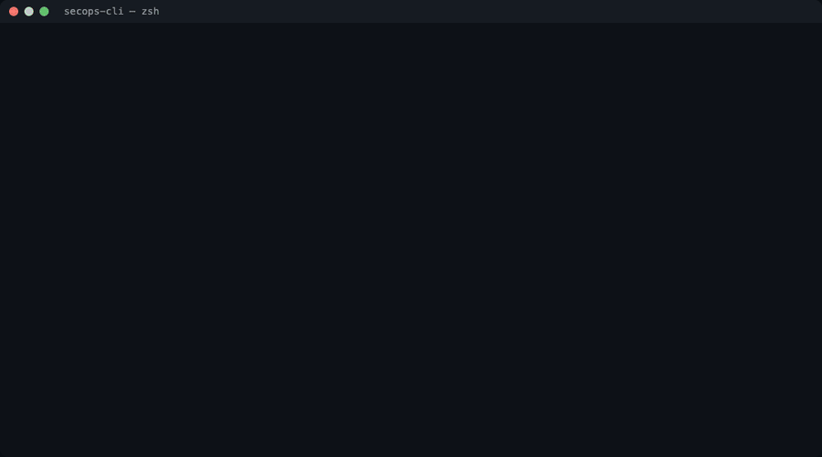

# secops-cli

[](https://github.com/Keniolax/secops-cli/actions/workflows/ci.yml)

Four small security tools behind one command, `secops`:

- `scan`: a TCP connect scan of hosts you own
- `logs`: SSH log triage that flags brute-force attempts
- `ssl`: a TLS certificate check that never switches verification off
- `fim`: a file integrity monitor, with live events and a full rescan on a schedule

Every command can print JSON with `--json`, and every exit code means the same thing: `0`
nothing to report, `1` findings, `2` could not run.



The recording replays a real session against [home-soc-lab](https://github.com/Keniolax/home-soc-lab),
my Wazuh lab. The output is unedited, except that absolute paths are shortened.

---

## Install

You need Python 3.11 or later.

```bash
pip install git+https://github.com/Keniolax/secops-cli.git
secops --help
```

Or from a clone, with the test tools:

```bash
git clone https://github.com/Keniolax/secops-cli.git
cd secops-cli
python3 -m venv .venv && . .venv/bin/activate
pip install ".[dev]"
pytest
```

## Use

### `secops scan` — which ports are open

```console
$ secops scan localhost -p 8000-8500
localhost (127.0.0.1): 1 open of 501 scanned
   8443/tcp  open
```

The scan only contacts loopback unless you add a network you own with `--allow`, for example
`--allow 172.18.0.0/16` for the lab's Docker network. The check runs before any packet leaves.
It resolves the name, checks every address the name resolves to, and then connects to the
checked address. It never looks the name up a second time, because a second lookup could
return a different address.

Each port is `open` (the handshake completed), `closed` (the host refused), or `filtered` (no
answer before the timeout, which usually means a firewall). One run scans at most 1,024 ports.

### `secops logs` — who is trying to log in

```console
$ secops logs demo/victim-auth.log
12 sshd events, 12 failed logins from 1 source
  172.18.0.6                                 12 failures  users: probe-1792699292
BRUTE FORCE  172.18.0.6: 8 failures between 2026-10-22T20:01:46+00:00 and 2026-10-22T20:01:47+00:00
```

That log came from the victim in home-soc-lab, after its own brute-force test. The rule is
the same as Wazuh rule 5712: 8 or more failed logins from one address within 120 seconds.
Change it with `--threshold` and `--window`.

The parser reads both syslog formats. Classic lines (`Oct 20 00:24:44 ...`) carry no year,
so the tool assumes the current year unless you pass `--year`. ISO lines carry their own.

### `secops ssl` — is this certificate trusted, and for how long

```console
$ secops ssl localhost:8443 --cafile demo/lab-root-ca.pem
localhost:8443: trusted, expires 2029-01-24T20:00:21+00:00 (824 days)
  subject: wazuh.dashboard
  issuer:  home-soc-lab-ca
  names:   wazuh.dashboard, localhost

$ secops ssl localhost:8443
localhost:8443: NOT TRUSTED: unable to get local issuer certificate
```

There is no option to skip verification. A checker that skips it reports "fine" on exactly
the certificates that are not. A lab that signs its own certificates passes its CA with
`--cafile` instead. A certificate that fails verification, or expires within 30 days
(`--warn-days`), is a finding: exit code 1.

### `secops fim` — did any file change

```console
$ secops fim init demo/etc --baseline demo/etc.baseline.json
baseline of 2 files under demo/etc saved to demo/etc.baseline.json (signed)

$ echo "evil:x:0:0::/root:/bin/bash" >> demo/etc/passwd

$ secops fim check --baseline demo/etc.baseline.json
demo/etc: 1 change(s) since baseline of 2026-10-22T20:02:53.298847+00:00
  MODIFIED  passwd (sha256, size)
```

`init` records the SHA-256 hash, size and permissions of every file, then signs the result
with an HMAC key. `check` refuses a baseline whose signature does not match, so nobody can
hide a change by editing the baseline without the key. The key lives in `~/.secops/fim.key`
(mode 600), or in `SECOPS_FIM_KEY`.

`watch` reports changes as the operating system announces them, and runs a full check when it
starts and every `--rescan` seconds:

```console
$ secops fim watch --baseline demo/w.baseline.json --rescan 5
2026-10-22T20:05:10.535845+00:00  RESCAN (start): 1 change(s) since baseline
2026-10-22T20:05:12.495516+00:00  MODIFIED  passwd
2026-10-22T20:05:12.509605+00:00  ADDED     .hidden-backdoor
2026-10-22T20:05:15.537987+00:00  RESCAN (schedule): 3 change(s) since baseline
```

In that run, `sshd_config` changed before the watcher started. The start-up check caught it.
The other two changes arrived as live events within milliseconds.

The tool never updates a baseline by itself. To accept a change, run `init --force`.

#### Run the check on a schedule

[`contrib/`](contrib/) holds ready files that run `secops fim check` every 15 minutes:
a launchd agent for macOS, a systemd service and timer for Linux, and a cron line. The
scheduler records the exit code of each run, so every finding shows up in its own logs.

---

## Design decisions

**Decision: the integrity monitor uses file events, backed by a scheduled full rescan.**
*Alternatives considered:* a one-shot check run by cron; a long-running loop that rescans;
file events alone.
*Why:* events give an alert within milliseconds, but they only see changes made while the
watcher runs. The kernel also drops events when its queue fills. So the full rescan is the
source of truth, and the events are an early warning. `fim check` exists so that the operating
system's scheduler can run the rescan even if the watcher has died. Wazuh's agent uses the same
two layers.
*Cost accepted:* two code paths to keep in step, and a dependency, `watchdog`, for the events.

**Decision: the network tools take their connection function as a parameter.**
*Alternatives considered:* call `socket` directly and mock it in tests.
*Why:* tests pass a fake connection and never touch the internet, so they behave the same on
my Mac and on GitHub's runners. The few tests that use real sockets stay on `127.0.0.1`,
against servers the tests start themselves.
*Cost accepted:* one more argument on `scan()` and `check()`.

**Decision: JSON output and exit codes, not only text.**
*Why:* text is for people. JSON feeds a SIEM, `jq` or a CI step. Exit codes let cron, launchd or
CI act on a finding without reading any text. Errors go to stderr, so piped JSON stays clean.

## Tests and CI

`pytest` runs 49 tests with no network access. They include a real TLS handshake against a
throwaway CA, real file events, and log lines modelled on home-soc-lab's.

To check that the tests can fail, I planted three bugs one at a time: a signature check that
always passes, a scope check that allows everything, and an off-by-one in the brute-force
threshold. Each one turned the suite red.

GitHub Actions runs `ruff` and the tests on every push, on Linux and macOS, with Python 3.11
and 3.13. File events come from inotify on Linux and FSEvents on macOS, so both matter. The
workflow installs the package the normal way, not in editable mode, so the tests run against
what `pip install` actually produces. Each action is pinned to a commit, and the job's token
can only read the repo.

## Limitations

- **Connect scan only.** No SYN scan, no UDP, no service detection. It needs no root access
  for the same reason.
- **English sshd messages only.** The log parser matches the messages OpenSSH writes. Other
  services and other languages are ignored.
- **No revocation check.** `ssl` does not ask OCSP or a CRL whether a certificate was revoked.
- **The HMAC key sits on the watched machine.** Root on that machine can read it and re-sign a
  baseline. To defend against that, the hashes must leave the machine, as a Wazuh agent sends
  them to its manager.
- **Large folders on Linux** can exceed the inotify watch limit
  (`fs.inotify.max_user_watches`). `watch` then fails to start. `fim check` from a scheduler
  still works, because it reads the files instead of waiting for events.
- **Not tested on Windows.**

## License

MIT. See [LICENSE](LICENSE).
